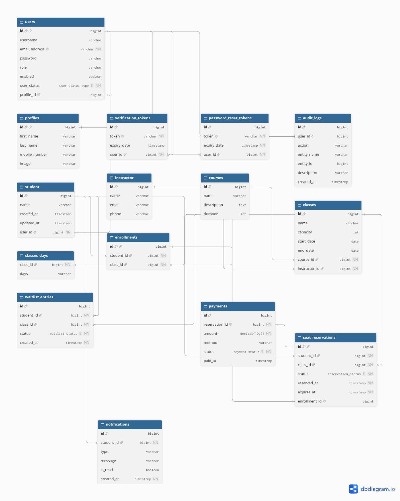

# Institute Management System

## Project Description

The **Institute Management System** is a RESTful backend application designed to manage the main operations of an educational institute.

The system provides functionality for managing users, students, instructors, courses, classes, enrollments, notifications, and audit logs. It also includes authentication and authorization using JWT and role-based access control.

**Project 3 extension:** the enrollment process is now a full **seat reservation and payment workflow**. A student reserves a seat in a class, has a limited time to pay, and is enrolled only after the payment succeeds. When a class is full, students join a waiting list, and a background job gives freed seats to the next student in line. Because many students can reserve the same last seat at the same moment, the project also demonstrates and solves a **race condition** using concurrency control and multithreading.

## Application Purpose

The purpose of this project is to develop a centralized system for managing an educational institute and its daily operations.

The system allows administrators to manage institute resources such as instructors, courses, classes (including their fees), users, and enrollments, while students can reserve seats, pay for classes, manage their enrollments, and receive notifications.

## Main Features

* User registration and authentication
* JWT-based authentication
* Role-based authorization
* Email/account verification
* Password reset and password change
* Profile update with profile image
* Student, instructor, course, and class management
* Class fee (each class has its own price)
* Student enrollment management and personal enrollment management
* **Seat reservation with a time limit** (default 10 minutes)
* **Payment** for a reservation, which confirms the enrollment
* **Waiting list** for full classes
* **Scheduled background job** that expires unpaid reservations and offers the seat to the next student in the waiting list
* **Reserve several classes at once**, one thread per class
* **Concurrency protection** for limited seats (semaphore, per-class lock, and database row locks)
* **Asynchronous notifications**: stored in the database and pushed in real time using Server-Sent Events (SSE)
* Audit logging
* Pagination and sorting for classes
* PostgreSQL database integration
* RESTful API
* Swagger / OpenAPI documentation
* Concurrency tests (JUnit)

---

## Technologies

* **Java**
* **Spring Boot**
* **Spring Security**
* **JWT**
* **Spring Data JPA**
* **Hibernate**
* **PostgreSQL**
* **Maven**
* **Swagger / OpenAPI**
* **Server-Sent Events (SSE)**
* **Java concurrency (`java.util.concurrent`)**: `Thread`, `Runnable`, `ExecutorService`, `Callable`, `Future`, `Semaphore`, `ReentrantLock`, `ConcurrentHashMap`, `CountDownLatch`, `AtomicInteger`
* **Spring `@Scheduled` and `@Async`**
* **JUnit**
* **Lombok**
* **Git**
* **GitHub**

---

## Architecture

The application follows a layered architecture to separate responsibilities between different parts of the system.

### Main Layers

**Controller Layer**: handles HTTP requests and responses and exposes the REST API endpoints.

**Service Layer**: contains the business logic (reservation, payment, waiting list, notifications).

**Repository Layer**: uses Spring Data JPA to communicate with PostgreSQL, including row-locking queries used for concurrency control.

**Model / Entity Layer**: JPA entities representing the database tables and relationships.

**Security Layer**: authentication and authorization using Spring Security and JWT.

**Scheduler / Config Layer**: the scheduled job for expiring reservations and the thread pool configuration for asynchronous work.

### Application Structure

```text
src/main/java/com/example/institute/institute
│
├── controller
│   ├── UserController
│   ├── StudentController
│   ├── InstructorController
│   ├── CourseController
│   ├── ClassController
│   ├── EnrollmentController
│   ├── ReservationController      (Project 3)
│   ├── PaymentController          (Project 3)
│   ├── MeController               (Project 3)
│   ├── NotificationController
│   └── AuditLogController
│
├── service
│   ├── UserService
│   ├── StudentService
│   ├── InstructorService
│   ├── CourseService
│   ├── ClassService
│   ├── EnrollmentService
│   ├── ReservationService         (Project 3)
│   ├── ReservationGate            (Project 3)
│   ├── BatchReservationService    (Project 3)
│   ├── PaymentService             (Project 3)
│   ├── NotificationService
│   └── ...
│
├── repository
│   ├── UserRepository
│   ├── StudentRepository
│   ├── ClassRepository
│   ├── EnrollmrntRepository
│   ├── SeatReservationRepository  (Project 3)
│   ├── PaymentRepository          (Project 3)
│   ├── WaitlistEntryRepository    (Project 3)
│   ├── RefundRepository           (Project 3)
│   ├── NotificationRepository     (Project 3)
│   └── ...
│
├── model
│   ├── User, UserProfile, Student, Instructor, Course, Class, Enrollment, AuditLog
│   ├── SeatReservation, Payment, WaitlistEntry, Refund, Notification   (Project 3)
│   ├── ReservationStatus, PaymentStatus, WaitlistStatus                (Project 3)
│   ├── request  (PaymentRequest, BatchReservationRequest, ...)
│   └── response (ReservationResponse, BatchReservationResult, ...)
│
├── scheduler
│   └── ReservationScheduler       (Project 3)
│
├── config
│   ├── WebConfig                  (serves uploaded profile images)
│   └── AsyncConfig                (Project 3: notification thread pool)
│
└── security
    ├── JwtRequestFilter
    ├── RateLimitFilter
    ├── JWTUtils
    ├── MyUserDetails
    └── SecurityConfiguration
```

---

## General Approach

The project was developed using a layered Spring Boot architecture where each component has a specific responsibility. Controllers handle API requests, services contain the business logic, repositories communicate with PostgreSQL through Spring Data JPA, and entities represent the application's data model.

Authentication and authorization were implemented using Spring Security and JWT. Users authenticate through the login endpoint and receive a JWT token that is used to access protected endpoints.

The application was developed incrementally. Project 2 delivered the main entities, CRUD operations, authentication, enrollments, notifications, and audit logging. Project 3 was then built step by step on top of it: first the new entities and repositories, then the reservation flow, the payment flow, a test that exposes the race condition, the fix, the scheduled expiry job, and finally asynchronous notifications. Each step was committed separately in Git.

---

## User Roles

### Admin

Administrators can manage users, students, instructors, courses, classes (including class fees), enrollments, and audit logs.

### Student

Students can:

* View their student information and update their profile
* View available classes
* Reserve a seat in one class, or in several classes at once
* Join the waiting list when a class is full
* Pay for a reservation to confirm their enrollment
* View and delete their own enrollments
* View their saved notifications and receive real-time notifications

---

## Seat Reservation and Payment Workflow

### Flow

```text
Student reserves a seat
        │
        ├── seat available ──► reservation HELD (expires after N minutes)
        │                           │
        │                           ├── student pays in time ──► payment PAID
        │                           │                             enrollment created
        │                           │                             reservation CONFIRMED
        │                           │
        │                           └── time runs out ──► scheduled job sets EXPIRED
        │                                                   seat offered to the next student
        │                                                   in the waiting list
        │
        └── class full ──► student added to the waiting list (WAITING)
                                │
                                └── seat offered ──► reservation HELD for that student (OFFERED)
                                                      pays ──► COMPLETED / does not pay ──► CANCELLED
```

### Business Rules

* A seat counts as taken when it belongs to a confirmed enrollment **or** to an active (not yet expired) reservation.
* A student cannot reserve a class they are already enrolled in.
* A student cannot hold two active reservations for the same class, or join the same waiting list twice.
* Only active accounts can reserve.
* A reservation can only be paid by its owner, while it is still `HELD` and before it expires.
* Each reservation has at most one payment.
* The payment amount is the fee of the class (`Class.fee`, required when creating a class).
* A seat is never given to a waiting student before the expired reservation has been released (same transaction).

### Response Codes

| Situation | Code |
| --- | --- |
| Seat reserved (`HELD`) | `201` |
| Class full, added to waiting list (`WAITLISTED`) | `200` |
| Duplicate active reservation, or already enrolled / already waiting | `409` |
| Paying a reservation that belongs to another student | `403` |
| Paying an expired reservation | `422` |
| Paying a reservation that is not `HELD` | `409` |
| System too busy to process the reservation | `503` |

### Configuration

```properties
# reservation hold time in minutes (default 10)
institute.reservation-minutes=10
```

The scheduled job runs every 30 seconds.

---

## Concurrency and Multithreading

### Concurrency-Sensitive Scenario

```text
Class capacity: 1 seat available

Student A ──► reserves the seat
Student B ──► reserves the same seat at the same moment
```

Only one student must get the seat. Every HTTP request is processed by its own thread (Tomcat), so requests for the same class really do run at the same time.

### The Race Condition

The reservation logic first **counts** the seats that are taken, then **compares** the count with the capacity, and finally **inserts** the reservation (a check-then-act sequence). Without protection, two threads can interleave like this:

```text
Thread 1: taken = 4, capacity = 5  → there is room
Thread 2: taken = 4, capacity = 5  → there is room
Thread 1: inserts reservation  → 5 taken
Thread 2: inserts reservation  → 6 taken   (more than the capacity)
```

This was reproduced with a test that fires 50 students at the same moment at a class with 5 seats.

### Protection (three layers)

| Layer | Tool | Purpose | Where |
| --- | --- | --- | --- |
| 1. Admission control | `Semaphore(10)` with `tryAcquire` (5 seconds) | Limits how many reservations run at the same time (similar to the database connection pool). If the system is busy, the student receives `503` instead of waiting forever | `ReservationGate` |
| 2. Per-class lock | `ReentrantLock` (fair) per class id, stored in a `ConcurrentHashMap`, with `tryLock` (5 seconds) | Requests for the same class are handled one at a time; different classes never block each other | `ReservationGate` |
| 3. Database lock | `@Lock(PESSIMISTIC_WRITE)` on the class row (`SELECT ... FOR UPDATE`), inside a `@Transactional` method | The real protection: it also works if the application runs on more than one instance, and it protects against the scheduled job | `ClassRepository.findWithLockById`, `ReservationService.reserveSeat` |

Payment and expiry also share a lock: `SeatReservationRepository.findWithLockById` locks the reservation row, so a payment that arrives at the same moment the scheduled job expires the reservation cannot succeed twice (the second one sees the new status).

**Why not only `synchronized`?** A `synchronized` method protects one JVM only, and with `@Transactional` the lock can be released before the transaction commits, so another thread may read old data. The database lock avoids both problems.

**Order of acquisition:** semaphore, then class lock, then the transaction with the database lock. The lock is released after the transaction commits.

### Deadlock Analysis

| Component | Locks taken, in order |
| --- | --- |
| Reservation | semaphore → class lock → class row |
| Payment | reservation row |
| Scheduled expiry | reservation row → class row |

No component acquires the same locks in the opposite order, so a circular wait cannot form. All waits have a timeout.

### Threads in the Application

| Thread | Created by | Work |
| --- | --- | --- |
| `http-nio-...` | Tomcat | One per HTTP request |
| `scheduling-1` | Spring `@Scheduled` | Expires reservations and promotes the waiting list |
| `notify-1`, `notify-2`, ... | `AsyncConfig` (`ThreadPoolTaskExecutor`: core 2, max 4, queue 100) | Saves notifications and pushes them through SSE (`@Async`) |
| `reserve-class-{id}` | `BatchReservationService` (`Thread` + `Runnable`) | One thread per class in a multi-class reservation, followed by `join` |

### Concurrency Tools Used

| Tool | Where |
| --- | --- |
| `Thread`, `Runnable`, `join` | `BatchReservationService`, `ConcurrentClassesReservationTest` |
| `ExecutorService`, `Callable`, `Future` | Concurrency tests |
| `CountDownLatch` | Tests: all threads start at the same moment |
| `AtomicInteger` | Tests: thread-safe counters |
| `Semaphore`, `ReentrantLock` | `ReservationGate` |
| `ConcurrentHashMap` | Class locks, batch results, SSE connections in `NotificationService` |
| `@Scheduled` | `ReservationScheduler` |
| `@Async` and a dedicated thread pool | `NotificationService`, `AsyncConfig` |
| Database row locks | `ClassRepository`, `SeatReservationRepository` |

### Reserve Several Classes at Once

`POST /api/reservations/batch` accepts up to 5 class ids. The student is resolved first (the security context is not available in new threads), then one thread is started per class, all threads are started before any `join`, and results are collected in a `ConcurrentHashMap`. A failure in one class does not affect the others.

### Concurrency Demonstration (tests)

Tests are in `src/test/java/com/example/institute/institute`. They create their own students, classes, and courses, and delete them afterwards.

| Test | Scenario | Result |
| --- | --- | --- |
| `ReservationConcurrencyTest` (without any protection) | 50 students, 1 class, 5 seats | **13** seats reserved (race condition, the number changes in every run) |
| `ReservationConcurrencyTest` (with the database lock) | 50 students, 1 class, 5 seats | **5** reserved, 45 on the waiting list, 0 errors |
| `ConcurrentClassesReservationTest` (executor) | 30 students, 6 classes, 3 seats each | 18 reserved (3 per class), 12 on the waiting list |
| `ConcurrentClassesReservationTest` (plain threads) | Same scenario with `Thread` and `Runnable`, printing thread states `NEW`, `RUNNABLE/WAITING`, `TERMINATED` | Same result |

Run them with:

```bash
./mvnw test
```

Manual scenario (Postman): create a class with capacity 1, reserve with student A (`201 HELD`) and student B (`200 WAITLISTED`), wait until A's reservation expires (the console shows `[scheduling-1] checking expired reservations...`), and B receives the seat and a notification; B pays and becomes enrolled.

---

## Asynchronous Notifications

`NotificationService.sendNotification` runs with `@Async` in a dedicated thread pool, so reserving a seat returns to the student immediately. Each notification is:

1. Saved in the `notifications` table (for students), so it is not lost when the student is offline.
2. Pushed in real time through SSE when the student is connected.

Notifications are sent when a seat is reserved, when a student joins the waiting list, when a reservation expires, when a seat is offered to a waiting student, and when a payment is received.

---

## User Stories

* As a user, I should be able to register and log in to the system.
* As a user, I should be able to verify my account and reset my password if needed.
* As a user, I should be able to update my profile and my profile image.
* As a student, I should be able to view my student information.
* As a student, I should be able to view available classes and their fees.
* As a student, I should be able to reserve a seat in a class and have it held for a limited time.
* As a student, I should be able to pay for my reservation to confirm my enrollment.
* As a student, I should be able to join a waiting list when a class is full.
* As a student, I should be offered a seat automatically when one becomes available.
* As a student, I should be able to reserve seats in several classes at once.
* As a student, I should be able to view and cancel my own enrollments.
* As a student, I should be able to see my notifications even if I was offline.
* As an administrator, I should be able to manage users and their accounts.
* As an administrator, I should be able to create, update, and delete instructors, courses, and classes, and set the fee of each class.
* As an administrator, I should be able to manage student enrollments.
* As an administrator, I should be able to view audit logs to track system activities.
* As a user, I should be able to receive real-time notifications from the system.
* As the system, two students must never get the same last seat, even if they reserve at the same moment.

---

## ERD

The Entity Relationship Diagram represents the relationships between the entities in the system.



The system contains 15 entities.

**Project 2 entities:** User, UserProfile, Student, Instructor, Course, Class, Enrollment, AuditLog, VerificationToken, PasswordResetToken.

**Project 3 entities:**

| Entity | Purpose |
| --- | --- |
| `SeatReservation` | A seat held temporarily for a student until `expiresAt` |
| `Payment` | The payment of a reservation (amount, method, status) |
| `WaitlistEntry` | A student waiting for a seat in a full class |
| `Refund` | A refund of a payment |
| `Notification` | A notification saved for a student |

**Changes to existing entities:** `Class` has a new `fee` field. No other table was changed.

---

## Planning

The project planning was managed using GitHub to track the project's scope, deliverables, tasks, and progress.

Project 3 was planned in these steps, each one committed separately:

1. New entities and repositories
2. Reservation flow (hold or waiting list)
3. Payment flow (reservation confirmed, student enrolled)
4. Test that exposes the race condition
5. Fix using database locks, then retest
6. Scheduled expiry and waiting list promotion
7. Asynchronous notifications
8. Reservation gate (semaphore and per-class lock) and multi-class reservation
9. Documentation

---

## API Documentation

The application provides a RESTful API documented using Swagger / OpenAPI.

### Swagger UI

```text
http://localhost:8080/swagger-ui/index.html
```

### OpenAPI Specification

```text
http://localhost:8080/v3/api-docs
```

### API Endpoints

| Request Type | URL                                           | Functionality                                         | Access  |
| ------------ | --------------------------------------------- | ----------------------------------------------------- | ------- |
| POST         | `/auth/users/login`                           | User login and JWT token generation                   | Public  |
| POST         | `/auth/users/register`                        | Register a new user                                   | Public  |
| GET          | `/auth/users/verify`                          | Verify user account                                   | Public  |
| POST         | `/auth/users/forgot-password`                 | Request password reset                                | Public  |
| POST         | `/auth/users/reset-password`                  | Reset user password                                   | Public  |
| PUT          | `/auth/users/changePassword`                  | Change password                                       | Private |
| PUT          | `/auth/users/{id}/reactivate`                 | Reactivate a user                                     | Admin   |
| DELETE       | `/auth/users/{id}`                            | Deactivate a user                                     | Admin   |
| GET          | `/api/me`                                     | Current user information                              | Private |
| PUT          | `/api/me`                                     | Update own profile and image (multipart)              | Private |
| GET          | `/api/students`                               | Get students                                          | Private |
| GET          | `/api/students/{studentId}`                   | Get student by ID                                     | Private |
| PUT          | `/api/students/{studentId}`                   | Update student                                        | Private |
| GET          | `/api/instructors`                            | Get all instructors                                   | Private |
| GET          | `/api/instructors/{instructorId}`             | Get instructor by ID                                  | Private |
| POST         | `/api/instructors`                            | Create an instructor                                  | Admin   |
| PUT          | `/api/instructors/{instructorId}`             | Update an instructor                                  | Admin   |
| DELETE       | `/api/instructors/{instructorId}`             | Delete an instructor                                  | Admin   |
| GET          | `/api/courses`                                | Get all courses                                       | Private |
| GET          | `/api/courses/{courseId}`                     | Get course by ID                                      | Private |
| POST         | `/api/courses`                                | Create a course                                       | Admin   |
| PUT          | `/api/courses/{courseId}`                     | Update a course                                       | Admin   |
| DELETE       | `/api/courses/{courseId}`                     | Delete a course                                       | Admin   |
| GET          | `/api/classes`                                | Get all classes (optional `name` or `courseId`)      | Private |
| GET          | `/api/classes/{classId}`                      | Get class by ID                                       | Private |
| POST         | `/api/classes`                                | Create a class (`fee` is required)                    | Admin   |
| PUT          | `/api/classes/{classId}`                      | Update a class                                        | Admin   |
| DELETE       | `/api/classes/{classId}`                      | Delete a class                                        | Admin   |
| GET          | `/api/classesSort`                            | Get sorted classes                                    | Private |
| GET          | `/api/classes/pagination`                     | Get paginated classes                                 | Private |
| POST         | `/api/classes/{classId}/reservations`         | Reserve a seat (`201 HELD` or `200 WAITLISTED`)       | Student |
| POST         | `/api/reservations/batch`                     | Reserve seats in up to 5 classes (one thread each)    | Student |
| POST         | `/api/reservations/{reservationId}/payment`   | Pay for a reservation and confirm the enrollment      | Student |
| GET          | `/api/enrollmrnts`                            | Get all enrollments                                   | Admin   |
| POST         | `/api/enrollmrnts`                            | Create an enrollment                                  | Private |
| GET          | `/api/myEnrollmrnt`                           | Get current user's enrollments                        | Private |
| GET          | `/api/enrollmrnts/{enrollmentId}`             | Get enrollment by ID                                  | Admin   |
| DELETE       | `/api/enrollmrnts/{enrollmentId}`             | Delete an enrollment                                  | Admin   |
| DELETE       | `/api/myEnrollmrnts/{enrollmentId}`           | Delete current user's enrollment                      | Private |
| GET          | `/api/notifications`                          | Get my saved notifications                            | Student |
| GET          | `/api/notifications/subscribe`                | Subscribe to real-time notifications (SSE)            | Private |
| GET          | `/api/auditLog`                               | Get audit logs                                        | Admin   |

### Examples

**Reserve a seat:** `POST /api/classes/31/reservations` (no body)

```json
{
  "status": "HELD",
  "reservationId": 1,
  "expiresAt": "2026-10-22T10:10:33",
  "waitlistPosition": null,
  "message": "Seat held for 10 minutes. Complete payment before it expires."
}
```

When the class is full:

```json
{
  "status": "WAITLISTED",
  "reservationId": null,
  "expiresAt": null,
  "waitlistPosition": 1,
  "message": "Class is full. You are number 1 on the waiting list."
}
```

**Pay:** `POST /api/reservations/1/payment`

```json
{ "method": "CARD" }
```

The body is optional (`CARD` is the default). The amount is the fee of the class.

**Reserve several classes:** `POST /api/reservations/batch`

```json
{ "classIds": [31, 32, 33] }
```

```json
[
  { "classId": 31, "status": "HELD", "message": "Seat held for 10 minutes. ..." },
  { "classId": 32, "status": "HELD", "message": "..." },
  { "classId": 33, "status": "WAITLISTED", "message": "Class is full. ..." }
]
```

---

## Installation

### 1. Clone the Repository

```bash
git clone https://github.com/devHassan19/Institute-Management-.git
```

```bash
cd Institute-Management-
```

### 2. Configure PostgreSQL

Install PostgreSQL and create a database for the application.

```sql
CREATE DATABASE institute;
```

### 3. Configure Environment Variables

```text
DB_URL=jdbc:postgresql://localhost:5432/institute
DB_USERNAME=your_username
DB_PASSWORD=your_password
JWT_SECRET=your_secret_key
```

Do not commit passwords, JWT secrets, or other sensitive credentials to GitHub.

Optional setting:

```properties
institute.reservation-minutes=10
```

### 4. Seed the Database

Run the required database setup or seed scripts to create the initial data.

```text
database/institute.sql
```

### 5. Build the Application

```bash
./mvnw clean install
```

### 6. Start the Application

```bash
./mvnw spring-boot:run
```

The application will start on `http://localhost:8080`.

### 7. Run the Concurrency Tests

```bash
./mvnw test
```

The tests use the configured database and remove the data they create.

### 8. Access Swagger

```text
http://localhost:8080/swagger-ui/index.html
```

---

## Authentication

The application uses JWT-based authentication. Users first authenticate using:

```text
POST /auth/users/login
```

The returned token must be included when accessing protected endpoints:

```text
Authorization: Bearer <JWT_TOKEN>
```

---

## Database

The application uses **PostgreSQL**. Spring Data JPA and Hibernate map Java entities to tables and manage relationships.

The main relationships include:

* User → UserProfile (one to one)
* User → Student (one to one)
* Course → Class
* Instructor → Class
* Student → Enrollment, Class → Enrollment
* Student → SeatReservation, Class → SeatReservation
* SeatReservation → Enrollment (set after payment)
* SeatReservation → Payment (one to one)
* Payment → Refund (one to one)
* Student → WaitlistEntry, Class → WaitlistEntry
* Student → Notification

---

## Unsolved Problems

* Payment is simulated (no real payment gateway).
* The `Refund` entity exists, but there is no cancellation and refund flow yet.
* When a confirmed enrollment is deleted, the freed seat is not automatically offered to the waiting list (this only happens when a reservation expires).
* The semaphore and per-class locks live in the memory of one application instance; the database row lock is what protects multiple instances.
* Notifications are sent before the surrounding transaction commits.
* Some endpoint names contain legacy naming inconsistencies, such as `/api/enrollmrnts`.
* Logging uses `System.out` instead of a logging framework.
* The concurrency tests call the service directly rather than sending HTTP requests.
* Additional validation and more automated tests could be added.

---

## Major Challenges

### JWT Authentication and Authorization

Implementing JWT authentication with Spring Security, a request filter, and role-based access control.

### Entity Relationships

Designing relationships between users, students, courses, instructors, classes, enrollments, and the new reservation, payment, and waiting list entities.

### Overbooking Under Concurrent Requests

The hardest problem of Project 3: the original capacity check followed a check-then-act pattern, so simultaneous requests reserved more seats than the capacity (13 seats in a class of 5 in the recorded run). It was solved with database row locks inside a transaction, and then hardened with a semaphore and per-class locks. The result is verified by the concurrency tests.

### Locking and Transactions Together

Locks must be released **after** the transaction commits, and `@Transactional` does not work when a method calls another method of the same class. The reservation logic was split into a service called from a separate gate component for this reason.

### Payment and Expiry Racing

A payment and the scheduled expiry job can touch the same reservation at the same moment. Locking the reservation row guarantees that only one of them wins.

### Real-Time Notifications

Server-Sent Events let clients subscribe to a stream without polling. Notifications are now also stored, and sent asynchronously so they never slow down the reservation request.

### API Documentation

Swagger/OpenAPI provides interactive documentation for the REST API.

---

## Future Improvements

* Build a dedicated frontend application.
* Add cancellation of reservations and enrollments with refunds, and offer freed seats to the waiting list.
* Integrate a real payment gateway.
* Replace `System.out` with a logging framework.
* Add HTTP-level concurrency tests and a payment-versus-expiry test.
* Add a unique constraint on enrollments (student and class).
* Add DTOs for payment and notification responses.
* Add automated database migrations using Flyway or Liquibase.
* Add CI/CD using GitHub Actions.
* Add email notifications for important events.

---

## Project Status

The project implements the main functionality required for managing an educational institute: authentication, authorization, students, instructors, courses, classes with fees, enrollments, notifications, and audit logging.

Project 3 adds the seat reservation and payment workflow, the waiting list with a scheduled background job, asynchronous stored notifications, and the concurrency protection that keeps seat counts correct under simultaneous requests. The REST API is documented with Swagger/OpenAPI and can be tested through the Swagger UI after starting the application.