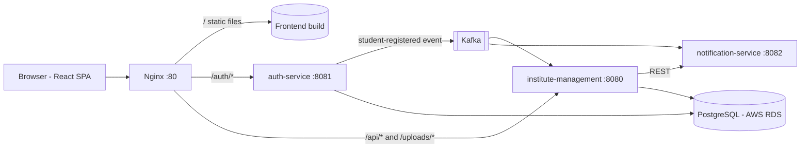
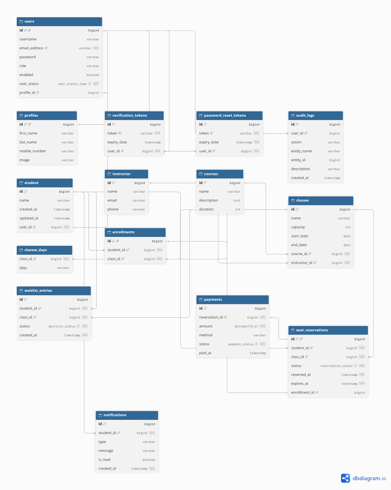

# Institute Management System

## Project Description

The **Institute Management System** is a microservices-based platform for managing the daily operations of an educational institute: users, students, instructors, courses, classes, enrollments, notifications, and audit logs. It includes JWT authentication with role-based access control, a React web interface, and is deployed to **AWS** with a **Jenkins** CI/CD pipeline.

The core of the system is a **seat reservation and payment workflow**. A student reserves a seat in a class, has a limited time to pay, and is enrolled only after the payment succeeds. When a class is full, students join a waiting list, and a background job gives freed seats to the next student in line. Because many students can reserve the same last seat at the same moment, the project also demonstrates and solves a **race condition** using concurrency control and multithreading.

**Project evolution:**

| Stage | What was delivered |
| --- | --- |
| Project 2 | Monolithic REST API: entities, CRUD, JWT security, enrollments, notifications, audit log |
| Project 3 | Seat reservation, payment, waiting list, scheduled expiry job, concurrency control, async notifications |
| Project 4 | Split into **microservices** (auth, institute, notification) with **Kafka**, **Nginx** gateway, **Docker**, **React frontend**, **Jenkins** pipeline, deployment on **AWS** (Elastic Beanstalk + RDS) |

## Application Purpose

Administrators manage institute resources (instructors, courses, classes and their fees, users, enrollments). Students browse classes, reserve seats, pay, manage their enrollments, and receive notifications in real time.

---

## Architecture



### Services

| Service | Port | Responsibility |
| --- | --- | --- |
| **nginx** | 80 | Single entry point: serves the React build and routes API requests to the right service |
| **auth-service** | 8081 | Registration, login (JWT), email verification, password reset and change, user activation. Publishes a `student-registered` event to Kafka |
| **institute-management** | 8080 | Business logic: students, instructors, courses, classes, enrollments, reservations, payments, waiting list, notifications, audit log. Consumes `student-registered` to create the student record |
| **notification-service** | 8082 | Consumes Kafka events and delivers real-time messages (SSE) |
| **kafka** | 19092 | Message broker (KRaft mode, single node) |
| **PostgreSQL (RDS)** | 5432 | Shared database used by auth-service and institute-management |

### Nginx Routing

| Path | Goes to |
| --- | --- |
| `/auth/**`, `/users/**`, `/api/users/**` | auth-service |
| `/api/notifications/subscribe` | institute-management (SSE, buffering disabled) |
| `/api/**`, `/uploads/**` | institute-management |
| everything else | React single-page app (`index.html`) |

Because the frontend and the API share the same address, no CORS configuration is needed.

### Event Flow: Registration

```text
1. User registers            ──► auth-service saves the user (not verified yet)
2. auth-service              ──► publishes "student-registered" to Kafka
3. institute-management      ──► consumes it and creates the Student record
4. notification-service      ──► consumes it and sends a welcome message
5. auth-service              ──► emails a verification link (APP_BASE_URL + /auth/users/verify?token=...)
6. User opens the link       ──► account verified, can log in
```

Events decouple the services: registration does not wait for the student record or the notification to be created.

### Layers Inside the Services

Each Spring Boot service follows a layered architecture:

* **Controller**: REST endpoints.
* **Service**: business logic (reservation, payment, waiting list, notifications).
* **Repository**: Spring Data JPA, including row-locking queries for concurrency control.
* **Model**: JPA entities and request/response objects.
* **Security**: Spring Security and JWT.
* **Scheduler / Config**: the expiry job and the thread pool for asynchronous work.

### Institute-Management Structure

```text
src/main/java/com/example/institute/institute
├── controller   (Student, Instructor, Course, Class, Enrollment, Reservation, Payment, Me, Notification, AuditLog)
├── service      (… ReservationService, ReservationGate, BatchReservationService, PaymentService, NotificationService)
├── repository   (… SeatReservation, Payment, WaitlistEntry, Refund, Notification)
├── model        (entities, enums, request, response)
├── scheduler    (ReservationScheduler)
├── config       (WebConfig, AsyncConfig)
└── security     (JwtRequestFilter, RateLimitFilter, JWTUtils, SecurityConfiguration)
```

---

## Main Features

* User registration, login, and **JWT** authentication with **role-based** authorization (Admin, Student)
* Email/account verification, password reset and change
* Profile update with profile image
* Student, instructor, course, and class management (each class has its own **fee**)
* **Seat reservation with a time limit** (default 10 minutes)
* **Payment** that confirms the enrollment
* **Waiting list** for full classes
* **Scheduled job** that expires unpaid reservations and offers the seat to the next student
* **Reserve several classes at once**, one thread per class
* **Concurrency protection** (semaphore, per-class lock, database row locks)
* **Notifications**: saved in the database and pushed in real time with **SSE**
* **Event-driven** communication between services with **Kafka**
* Audit logging, pagination and sorting for classes
* **React web interface** (student and admin views)
* **Dockerized** services, **Jenkins** pipeline, **AWS** deployment
* Swagger / OpenAPI documentation
* Concurrency tests (JUnit)

---

## Technologies

| Area | Tools |
| --- | --- |
| Backend | Java 17, Spring Boot, Spring Security, JWT, Spring Data JPA, Hibernate, Lombok |
| Messaging | Apache Kafka (Spring Kafka) |
| Database | PostgreSQL (AWS RDS) |
| Frontend | React, Vite |
| Gateway | Nginx |
| DevOps | Docker, Docker Compose, Jenkins, AWS Elastic Beanstalk, AWS S3, AWS RDS |
| Concurrency | `Thread`, `Runnable`, `ExecutorService`, `Callable`, `Future`, `Semaphore`, `ReentrantLock`, `ConcurrentHashMap`, `CountDownLatch`, `AtomicInteger`, Spring `@Scheduled` and `@Async` |
| Real time | Server-Sent Events (SSE) |
| Testing and docs | JUnit, Swagger / OpenAPI, Postman |
| Version control | Git, GitHub |

---

## User Roles

**Admin**: manages users, students, instructors, courses, classes (including fees), enrollments, and audit logs.

**Student**: views and updates their profile, browses classes, reserves seats (one class or several at once), joins waiting lists, pays reservations, manages their own enrollments, and receives notifications.

---

## Seat Reservation and Payment Workflow

```text
Student reserves a seat
        │
        ├── seat available ──► reservation HELD (expires after N minutes)
        │                           │
        │                           ├── student pays in time ──► payment PAID
        │                           │                             enrollment created
        │                           │                             reservation CONFIRMED
        │                           │
        │                           └── time runs out ──► scheduled job sets EXPIRED
        │                                                   seat offered to the next student
        │                                                   in the waiting list
        │
        └── class full ──► student added to the waiting list (WAITING)
                                │
                                └── seat offered ──► reservation HELD for that student (OFFERED)
                                                      pays ──► COMPLETED / does not pay ──► CANCELLED
```

### Business Rules

* A seat counts as taken when it belongs to a confirmed enrollment **or** to an active (not yet expired) reservation.
* A student cannot reserve a class they are already enrolled in, hold two active reservations for the same class, or join the same waiting list twice.
* Only active accounts can reserve.
* A reservation can only be paid by its owner, while it is `HELD` and before it expires.
* Each reservation has at most one payment, and the amount is the class fee.
* A seat is never given to a waiting student before the expired reservation has been released (same transaction).

### Response Codes

| Situation | Code |
| --- | --- |
| Seat reserved (`HELD`) | `201` |
| Class full, added to waiting list (`WAITLISTED`) | `200` |
| Duplicate active reservation, already enrolled, or already waiting | `409` |
| Paying a reservation that belongs to another student | `403` |
| Paying an expired reservation | `422` |
| Paying a reservation that is not `HELD` | `409` |
| System too busy to process the reservation | `503` |

The hold time is configurable with `institute.reservation-minutes` (default 10). The scheduled job runs every 30 seconds.

---

## Concurrency and Multithreading

### The Race Condition

The reservation logic first **counts** the seats that are taken, then **compares** the count with the capacity, and finally **inserts** the reservation (check-then-act). Without protection, two threads can both see "there is room" and both insert, so the class is overbooked. Every HTTP request runs in its own Tomcat thread, so this happens for real.

### Protection (three layers)

| Layer | Tool | Purpose | Where |
| --- | --- | --- | --- |
| 1. Admission control | `Semaphore(10)` with `tryAcquire` (5 s) | Limits concurrent reservations; if busy, the student gets `503` instead of waiting forever | `ReservationGate` |
| 2. Per-class lock | Fair `ReentrantLock` per class id in a `ConcurrentHashMap`, `tryLock` (5 s) | Requests for the same class run one at a time; different classes never block each other | `ReservationGate` |
| 3. Database lock | `@Lock(PESSIMISTIC_WRITE)` on the class row (`SELECT ... FOR UPDATE`) inside `@Transactional` | The real protection: it also works across several application instances and against the scheduled job | `ClassRepository.findWithLockById`, `ReservationService.reserveSeat` |

Payment and expiry share a lock on the reservation row (`SeatReservationRepository.findWithLockById`), so a payment that arrives exactly when the scheduler expires the reservation cannot succeed twice.

**Why not only `synchronized`?** It protects one JVM only, and with `@Transactional` the lock can be released before the transaction commits. The database lock avoids both problems.

### Deadlock Analysis

| Component | Locks taken, in order |
| --- | --- |
| Reservation | semaphore → class lock → class row |
| Payment | reservation row |
| Scheduled expiry | reservation row → class row |

No component takes the same locks in the opposite order, so a circular wait cannot form, and every wait has a timeout.

### Threads in the Application

| Thread | Created by | Work |
| --- | --- | --- |
| `http-nio-...` | Tomcat | One per HTTP request |
| `scheduling-1` | `@Scheduled` | Expires reservations and promotes the waiting list |
| `notify-1`, `notify-2`, ... | `AsyncConfig` (`ThreadPoolTaskExecutor`: core 2, max 4, queue 100) | Saves and pushes notifications (`@Async`) |
| `reserve-class-{id}` | `BatchReservationService` (`Thread` + `Runnable`) | One thread per class in a multi-class reservation, followed by `join` |

### Reserve Several Classes at Once

`POST /api/reservations/batch` accepts up to 5 class ids. The student is resolved first (the security context is not available in new threads), one thread is started per class, all threads start before any `join`, and results are collected in a `ConcurrentHashMap`. A failure in one class does not affect the others.

### Concurrency Tests

Tests are in `institute-management/src/test/java/...`. They create their own data and delete it afterwards.

| Test | Scenario | Result |
| --- | --- | --- |
| `ReservationConcurrencyTest` (no protection) | 50 students, 1 class, 5 seats | **13** seats reserved (race condition; the number changes each run) |
| `ReservationConcurrencyTest` (with database lock) | 50 students, 1 class, 5 seats | **5** reserved, 45 on the waiting list, 0 errors |
| `ConcurrentClassesReservationTest` (executor) | 30 students, 6 classes, 3 seats each | 18 reserved (3 per class), 12 waiting |
| `ConcurrentClassesReservationTest` (plain threads) | Same scenario with `Thread` and `Runnable` | Same result |

```bash
cd institute-management
./mvnw test
```

---

## Notifications

`NotificationService.sendNotification` runs with `@Async` in a dedicated thread pool, so reserving a seat returns to the student immediately. Each notification is:

1. **Saved** in the `notifications` table (for students), so it is not lost when the student is offline.
2. **Pushed live** over SSE to the connected browser.
3. **Forwarded** to the notification-service.

The web interface also checks for new notifications every few seconds as a fallback, so notifications still arrive if a proxy delays the live stream.

Notifications are sent when a seat is reserved, when a student joins the waiting list, when a reservation expires, when a seat is offered to a waiting student, and when a payment is received. A welcome message is sent through Kafka when a student registers.

---

## Frontend

A React single-page application (built with Vite) provides the student and admin interfaces: class browsing with search, reservation with a live countdown, payment, waiting list, enrollments, notifications (live bell and history), and profile management.

* The production build is served by Nginx from `aws-deployment/frontend`.
* The app calls the API with relative paths (`/api/...`, `/auth/...`), so it works behind the same Nginx without extra configuration.
* Server times arrive without a timezone (the servers run in UTC), and the app reads them as UTC so countdowns are correct in any browser timezone.

**Rebuild and redeploy the frontend:**

```bash
cd institute-frontend
npm install
npm run build
rm -rf ../aws-deployment/frontend
cp -r dist ../aws-deployment/frontend
```

Then commit and push, and run the Jenkins pipeline.

---

## API Documentation

Swagger UI (locally): `http://localhost:8080/swagger-ui/index.html`

OpenAPI specification: `http://localhost:8080/v3/api-docs`

### Endpoints

Authentication endpoints are served by **auth-service** (`/auth/...`); all `/api/...` endpoints by **institute-management**.

| Request | URL | Functionality | Access |
| --- | --- | --- | --- |
| POST | `/auth/users/login` | Login and JWT generation | Public |
| POST | `/auth/users/register` | Register a new user (multipart) | Public |
| GET | `/auth/users/verify` | Verify an account with a token | Public |
| POST | `/auth/users/forgot-password` | Request password reset | Public |
| POST | `/auth/users/reset-password` | Reset password | Public |
| PUT | `/auth/users/changePassword` | Change password | Private |
| PUT | `/auth/users/{id}/reactivate` | Reactivate a user | Admin |
| DELETE | `/auth/users/{id}` | Deactivate a user | Admin |
| GET | `/api/me` | Current user information | Private |
| PUT | `/api/me` | Update own profile and image (multipart) | Private |
| GET | `/api/students`, `/api/students/{id}` | Get students | Private |
| PUT | `/api/students/{id}` | Update a student | Private |
| GET | `/api/instructors`, `/api/instructors/{id}` | Get instructors | Private |
| POST / PUT / DELETE | `/api/instructors`, `/api/instructors/{id}` | Manage instructors | Admin |
| GET | `/api/courses`, `/api/courses/{id}` | Get courses | Private |
| POST / PUT / DELETE | `/api/courses`, `/api/courses/{id}` | Manage courses | Admin |
| GET | `/api/classes`, `/api/classes/{id}` | Get classes (optional `name` or `courseId`) | Private |
| POST / PUT / DELETE | `/api/classes`, `/api/classes/{id}` | Manage classes (`fee` required) | Admin |
| GET | `/api/classesSort`, `/api/classes/pagination` | Sorted and paginated classes | Private |
| POST | `/api/classes/{classId}/reservations` | Reserve a seat (`201 HELD` or `200 WAITLISTED`) | Student |
| POST | `/api/reservations/batch` | Reserve up to 5 classes (one thread each) | Student |
| POST | `/api/reservations/{reservationId}/payment` | Pay and confirm the enrollment | Student |
| GET | `/api/enrollmrnts`, `/api/enrollmrnts/{id}` | Get enrollments | Admin |
| POST | `/api/enrollmrnts` | Create an enrollment | Private |
| GET | `/api/myEnrollmrnt` | Current user's enrollments | Private |
| DELETE | `/api/enrollmrnts/{id}` | Delete an enrollment | Admin |
| DELETE | `/api/myEnrollmrnts/{id}` | Delete own enrollment | Private |
| GET | `/api/notifications/list` | My saved notifications | Student |
| GET | `/api/notifications/subscribe` | Real-time notifications (SSE) | Private |
| GET | `/api/auditLog` | Audit logs | Admin |

### Examples

**Reserve a seat:** `POST /api/classes/31/reservations` (no body)

```json
{
  "status": "HELD",
  "reservationId": 1,
  "expiresAt": "2026-10-22T10:10:33",
  "waitlistPosition": null,
  "message": "Seat held for 10 minutes. Complete payment before it expires."
}
```

When the class is full:

```json
{
  "status": "WAITLISTED",
  "reservationId": null,
  "expiresAt": null,
  "waitlistPosition": 1,
  "message": "Class is full. You are number 1 on the waiting list."
}
```

**Pay:** `POST /api/reservations/1/payment` with `{ "method": "CARD" }` (the body is optional).

**Reserve several classes:** `POST /api/reservations/batch` with `{ "classIds": [31, 32, 33] }`.

---

## ERD



The system contains 15 tables. The main chain is `Student → SeatReservation → Payment → Enrollment`, supported by `WaitlistEntry`, `Notification`, `Refund`, and the course/class/instructor entities.

**Note:** `Student.user_id` links to the user in auth-service by id only (no foreign key), because each service owns its own data.

---

## Running Locally

### Prerequisites

Java 17, Maven, Docker, Docker Compose, and Node.js (for the frontend).

### 1. Clone

```bash
git clone https://github.com/devHassan19/Institute-Management-.git
cd Institute-Management-
```

### 2. Configure Environment Variables

Create an `.env` file and fill in your values. **Never commit it to GitHub.**

```text
DB_URL=jdbc:postgresql://<host>:5432/<database>
DB_USERNAME=...
DB_PASSWORD=...
JWT_SECRET=...
MAIL_USERNAME=...
MAIL_PASSWORD=...
APP_BASE_URL=http://localhost
```

### 3. Start Everything with Docker Compose

```bash
docker compose up --build
```

This starts Nginx, Kafka, and the three services. Open `http://localhost`.

### 4. Run a Service Without Docker (optional)

```bash
cd auth-service && ./mvnw spring-boot:run          # port 8081
cd institute-management && ./mvnw spring-boot:run  # port 8080
cd notification-service && ./mvnw spring-boot:run  # port 8082
```

### 5. Frontend Development

```bash
cd institute-frontend
npm install
npm run dev     # http://localhost:5173, proxies /auth to 8081 and /api to 8080
```

### Authentication

Log in with `POST /auth/users/login`, then send the token on protected requests:

```text
Authorization: Bearer <JWT_TOKEN>
```

---

## Deployment on AWS

```text
GitHub ──► Jenkins ──► Maven build ──► deployment.zip ──► S3 ──► Elastic Beanstalk (Docker) ──► Nginx + 3 services + Kafka
                                                                              └──► PostgreSQL on RDS
```

### CI/CD Pipeline (Jenkins)

| Stage | What it does |
| --- | --- |
| Pull from GitHub | Clones the `main` branch |
| Build with Maven | Builds the three services (`clean package -DskipTests`) |
| Prepare Deployment | Copies the jars into `aws-deployment/` and zips the folder (it already contains the frontend build, `docker-compose.yml`, and `nginx.conf`) |
| Deploy to AWS | Uploads the zip to S3, creates an Elastic Beanstalk application version, and updates the environment |

AWS credentials are stored as Jenkins credentials, never in the repository.

### Environment Properties (Elastic Beanstalk)

| Property | Purpose |
| --- | --- |
| `DB_URL`, `DB_USERNAME`, `DB_PASSWORD` | RDS connection |
| `JWT_SECRET` | JWT signing key |
| `MAIL_USERNAME`, `MAIL_PASSWORD` | Sender account for verification emails |
| `APP_BASE_URL` | Public base URL used to build the email verification link (no trailing slash) |
| `INTERNAL_API_SECRET` | Secret for internal service-to-service calls |

### Updating the Application

1. Commit and push to `main`.
2. Run **Build Now** in Jenkins.
3. Wait for the Elastic Beanstalk environment to return to **Ok** (the services take a couple of minutes to start; a temporary `502` is normal during this time).

Changing only an Environment property does not need a build: apply it in Elastic Beanstalk.

### Database Migration

The database was moved from a local PostgreSQL to RDS with `pg_dump` and `psql`. The RDS security group only allows the application and a temporary administrator IP.

---

## Planning

The project was planned and tracked using GitHub. Project 3 was built in committed steps: new entities, reservation flow, payment flow, a test that exposes the race condition, the fix with database locks, the scheduled expiry job, asynchronous notifications, the reservation gate and multi-class reservation, and documentation. Project 4 then split the monolith into services, added Kafka, containerized everything, built the frontend, and automated deployment.

---

## Unsolved Problems

* Payment is simulated (no real payment gateway).
* The `Refund` entity exists, but there is no cancellation and refund flow yet.
* When a confirmed enrollment is deleted, the freed seat is not automatically offered to the waiting list.
* The semaphore and per-class locks live in the memory of one instance; the database row lock is what protects multiple instances.
* auth-service and institute-management share one database (not yet one database per service), and the user-student link is by id only.
* The profile image uploaded during registration is stored inside the auth-service container and is not served by institute-management, so it does not appear; images uploaded later from the profile page work.
* Real-time delivery depends on a single institute-management instance (SSE connections are kept in memory).
* The Kafka welcome message is delivered live only; it is not stored in the notifications table.
* The application runs on a single small instance with one Kafka node and no HTTPS.
* Some endpoint names contain legacy inconsistencies, such as `/api/enrollmrnts`.
* Logging uses `System.out` instead of a logging framework.
* The concurrency tests call the service directly rather than through HTTP.

---

## Major Challenges

### Overbooking Under Concurrent Requests

The original capacity check was check-then-act, so simultaneous requests reserved more seats than the capacity (13 in a class of 5). It was solved with database row locks inside a transaction, hardened with a semaphore and per-class locks, and verified by the concurrency tests.

### Locking and Transactions Together

Locks must be released **after** the transaction commits, and `@Transactional` does not apply when a method calls another method in the same class, so the reservation logic was split into a service called from a separate gate component.

### Payment and Expiry Racing

A payment and the expiry job can touch the same reservation at the same moment. Locking the reservation row guarantees that only one of them wins.

### Splitting the Monolith

Moving to microservices required Nginx routing, Kafka events between services, and restoring features that depended on the old single application. For example, notifications had to be persisted again after the split so the history page works.

### Deployment Issues Found on AWS

* **Verification links pointed to a local tunnel URL** instead of the public address; fixed by reading the base URL from the `APP_BASE_URL` environment property.
* **Countdowns showed every reservation as expired**, because the servers run in UTC while times were read in the browser's local timezone; fixed by reading server times as UTC.
* **Live notifications were delayed**, because proxies buffer streaming responses; fixed by disabling proxy buffering for the SSE route and adding a polling fallback.
* **Moving data to RDS** required opening the database security group to a single administrator IP, then closing it again.

### JWT Authentication and Authorization

Implementing JWT with Spring Security, a request filter, and role-based access control across services.

---

## Future Improvements

* Cancellation of reservations and enrollments with refunds, offering freed seats to the waiting list.
* A real payment gateway.
* One database per service, or a shared user-id contract with stronger guarantees.
* Store uploaded images in S3 so every service can serve them.
* HTTPS with a custom domain (CloudFront or a load balancer with a certificate).
* A managed Kafka service (MSK) and multiple instances behind a load balancer, with notifications shared through a broker instead of in-memory SSE connections.
* Replace `System.out` with a logging framework and add central logging and monitoring.
* HTTP-level concurrency tests and a payment-versus-expiry test.
* A unique constraint on enrollments (student and class).
* Database migrations with Flyway or Liquibase.
* Run tests in the Jenkins pipeline and build the frontend there too.
* Email notifications for important events.

---

## Project Status

The system implements the full institute workflow: authentication and authorization, students, instructors, courses, classes with fees, enrollments, reservation and payment with a waiting list, asynchronous stored notifications, audit logging, and concurrency protection that keeps seat counts correct under simultaneous requests. It runs as three Spring Boot microservices behind Nginx with Kafka, has a React web interface, and is deployed to AWS through a Jenkins pipeline.
